> [!NOTE]
> LiveInk is a full-stack, real-time collaborative whiteboard application that allows multiple users to draw, write text, and chat together on a shared infinite canvas. Think "Google Docs meets a whiteboard."

---

## 📋 Table of Contents

- [Tech Stack](#tech-stack)
- [System Architecture](#system-architecture)
- [Database Schema](#database-schema)
- [Backend Deep Dive](#backend-deep-dive)
  - [Express Server & Middleware](#express-server--middleware)
  - [Socket.IO Event System](#socketio-event-system)
  - [Room Service (In-Memory + DB)](#room-service-in-memory--db)
  - [Authentication System](#authentication-system)
  - [REST API Reference](#rest-api-reference)
- [Frontend Deep Dive](#frontend-deep-dive)
  - [Routing & Pages](#routing--pages)
  - [Redux State Management](#redux-state-management)
  - [Canvas Rendering Pipeline (Konva)](#canvas-rendering-pipeline-konva)
  - [Custom Hooks](#custom-hooks)
  - [Component Hierarchy](#component-hierarchy)
- [Real-Time Collaboration — Complete Data Flows](#real-time-collaboration--complete-data-flows)
- [Performance Optimizations](#performance-optimizations)
- [Docker & Deployment](#docker--deployment)
- [Known Issues & Bugs](#known-issues--bugs)

---

## Tech Stack

| Layer | Technology | Version | Purpose |
|-------|-----------|---------|---------|
| **Frontend Framework** | React | 19.0.0 | UI rendering |
| **Build Tool** | Vite | 6.4.2 | Dev server & bundling |
| **Canvas Engine** | Konva + react-konva | 9.3.20 / 19.0.3 | 2D canvas rendering (HTML5 Canvas) |
| **State Management** | Redux Toolkit | 2.6.1 | Global state (drawing, room, UI) |
| **Styling** | Tailwind CSS v4 | 4.0.17 | Utility-first CSS |
| **UI Primitives** | Radix UI + shadcn/ui | Various | Accessible UI components |
| **Icons** | Lucide React, React Icons | — | SVG icon library |
| **Color Picker** | react-color | 2.19.3 | ChromePicker for fill colors |
| **Routing** | React Router DOM | 7.15.1 | Client-side routing |
| **Real-Time Transport** | Socket.IO Client | 4.8.3 | WebSocket communication |
| **Binary Serialization** | protobufjs | 8.5.0 | Protocol Buffer encoding/decoding for WebSocket payloads |
| **HTTP Client** | Axios | 1.16.1 | REST API calls |
| **UUID** | uuid | 11.1.0 | Unique IDs for shapes/text |
| **Backend Runtime** | Node.js | 24 (Alpine) | Server runtime |
| **Backend Framework** | Express.js | 4.21.2 | HTTP server |
| **WebSocket Server** | Socket.IO | 4.8.1 | Bidirectional real-time events |
| **Database** | PostgreSQL | Latest | Persistent storage |
| **ORM / Driver** | pg (node-postgres) | 8.14.1 | Raw SQL queries |
| **Authentication** | JWT (jsonwebtoken) | 9.0.2 | Token-based auth |
| **OAuth** | Passport.js | 0.7.0 | Google + GitHub OAuth |
| **Password Hashing** | bcryptjs | 3.0.2 | Secure password storage (user & room passwords) |
| **Rate Limiting** | express-rate-limit | 8.5.2 | API abuse prevention |
| **Room IDs** | nanoid | 5.1.5 | Short unique room identifiers |
| **Containerization** | Docker + Docker Compose | 3.8 spec | Multi-service deployment |

---

## System Architecture

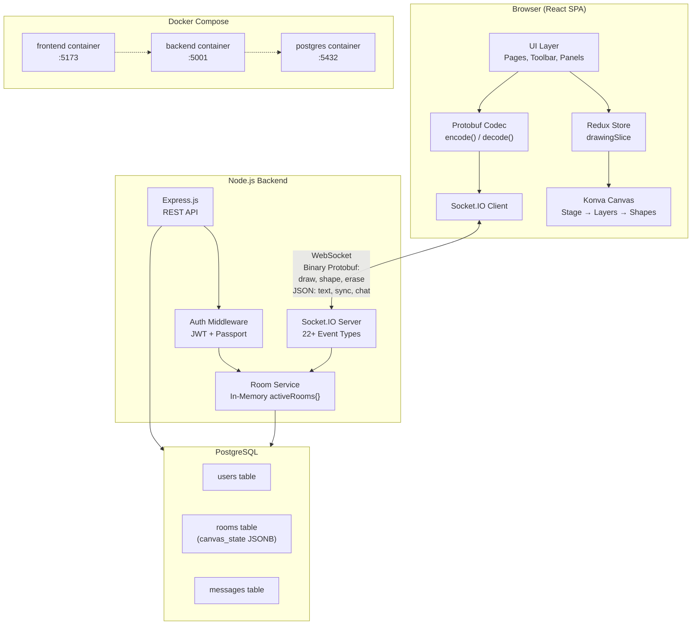

### High-Level Request Flow

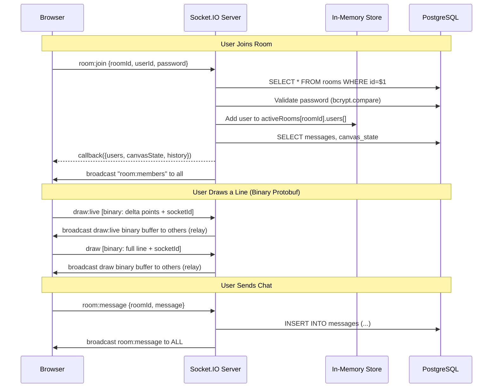

---

## Database Schema

```sql
-- init.sql

CREATE TABLE IF NOT EXISTS users (
    id          SERIAL PRIMARY KEY,
    username    VARCHAR(255) UNIQUE NOT NULL,
    email       VARCHAR(255) UNIQUE NOT NULL,
    password    TEXT NOT NULL,           -- bcrypt hash (or "google-oauth"/"github-oauth" sentinel)
    created_at  TIMESTAMP DEFAULT CURRENT_TIMESTAMP
);

CREATE TABLE IF NOT EXISTS rooms (
    id          VARCHAR(255) PRIMARY KEY, -- nanoid(8)
    name        VARCHAR(255) NOT NULL,
    password    TEXT,                     -- bcrypt hashed room password
    creator_id  INTEGER REFERENCES users(id) ON DELETE SET NULL,
    canvas_state JSONB DEFAULT '{}',     -- Full canvas snapshot {lines, shapes, texts}
    created_at  TIMESTAMP DEFAULT CURRENT_TIMESTAMP
);

CREATE TABLE IF NOT EXISTS messages (
    id          SERIAL PRIMARY KEY,
    room_id     VARCHAR(255) REFERENCES rooms(id) ON DELETE CASCADE,
    username    VARCHAR(255) NOT NULL,
    text        TEXT NOT NULL,
    timestamp   BIGINT NOT NULL,         -- Unix epoch (ms)
    created_at  TIMESTAMP DEFAULT CURRENT_TIMESTAMP
);
```

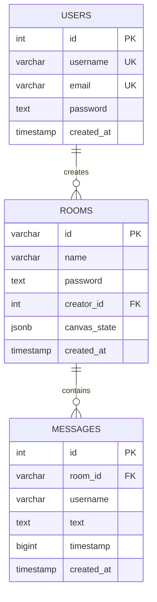

---

## Backend Deep Dive

### Express Server & Middleware

**File:** `backend/server.js` (292 lines)

Middleware chain applied in order:

```
1. express-session        → Session management (for Passport OAuth)
2. cors                   → Origin: CLIENT_URL || "http://localhost:5173"
3. express.json()         → JSON body parsing
4. passport.initialize()  → Passport setup
5. passport.session()     → Passport session support
```

**Route Mounting:**

| Path Prefix | Router File | Purpose |
|------------|------------|---------|
| `/api/auth` | `authRoutes.js` | Login, Register, Get User |
| `/auth` | `oauthRoutes.js` | Google & GitHub OAuth flows |
| `/api/rooms` | `roomRoutes.js` | REST room create/join |

**Environment Variables:**

| Variable | Default Fallback | Used In |
|----------|-----------------|---------|
| `CLIENT_URL` | `http://localhost:5173` | CORS origin |
| `JWT_SECRET` | `Your_secret_key` | Token signing (consistent across all modules) |
| `SESSION_SECRET` | `some_secret` | Express session |
| `PORT` | `5001` | Server listen port |
| `DATABASE_URL` | — | PostgreSQL connection |
| `GOOGLE_CLIENT_ID` | — | OAuth |
| `GOOGLE_CLIENT_SECRET` | — | OAuth |
| `GITHUB_CLIENT_ID` | — | OAuth |
| `GITHUB_CLIENT_SECRET` | — | OAuth |
| `SERVER_URL` | `http://localhost:5001` | OAuth callback URLs |

---

### Socket.IO Event System

> [!IMPORTANT]
> Socket.IO is the backbone of the entire real-time collaboration system. The server acts purely as a **relay** for drawing events — it does NOT process, validate, or store individual drawing strokes. Only `room:message` (chat) and `sync:state` (canvas snapshots) hit the database.

#### Socket Authentication Middleware

```javascript
io.use((socket, next) => {
  const token = socket.handshake.auth.token;
  if (!token) {
    return next(new Error("Authentication error: No token provided"));
  }
  // Verify JWT → sets socket.userId = decoded.id
});
```

#### Complete Event Reference (22+ Events)

##### Room Management Events

| Event | Direction | Payload | Behavior |
|-------|-----------|---------|----------|
| `room:create` | Client → Server | `{userId, roomName, password, username}` + callback | Creates room in DB (password bcrypt-hashed) + memory, `socket.join(roomId)` |
| `room:join` | Client → Server | `{roomId, userId, username, password}` + callback | Validates room (bcrypt.compare), joins, returns `{users, canvasState, history, createdBy}` |
| `room:members` | Client → Server | `{roomId}` + callback | Returns in-memory member list |
| `room:members` | Server → Client | `{members, createdBy}` | Broadcast after join/leave |
| `leave-room` | Client → Server | `{roomId, userId}` | `socket.leave()`, remove from memory |
| `user-joined` | Server → Client | `{userId, username}` | Notification to existing room members |
| `disconnect` | Auto | — | Same as `leave-room` |

##### Drawing Events (Pure Relay — No DB — Binary Protobuf)

> [!TIP]
> Events marked with 🔹 are **binary encoded** using Protocol Buffers. The server relays the raw `Buffer` without parsing — zero deserialization overhead on the backend.

| Event | Format | Payload | Purpose |
|-------|--------|---------|--------|
| `draw` | 🔹 Binary | `DrawFinal {points[], tool, stroke, strokeWidth, opacity, dash[], socketId}` | Finalized freehand line |
| `draw:live` | 🔹 Binary | `DrawLive {points[], tool, socketId}` | **Delta-encoded** — only new points since last emit |
| `drawShape` | 🔹 Binary | `ShapeFinal {id, tool, x, y, width, height, fill, type, socketId}` | Finalized shape |
| `shape:live` | 🔹 Binary | `ShapeLive {type, x, y, width, height, radius, fill, socketId}` | Live shape preview while dragging |
| `erase` | 🔹 Binary | `EraseBatch {points[{x,y}], radius}` | Batched eraser coordinates per stroke |
| `shape:update` | JSON | `{id, updatedShape}` | Shape transform/move by selector |
| `shape:fill` | JSON | `{id, fill}` | Paint bucket applied to shape |

##### Text Events (Pure Relay — No DB)

| Event | Payload | Purpose |
|-------|---------|---------|
| `text:start` | `{id, x, y, text, fontSize, draggable, fill, fontStyle, fontFamily}` | New text element created |
| `text:update` | `{id, text?, x?, y?}` | Text content or position changed |
| `text:commit` | Text object | Text editing finalized |
| `text:fill` | `{id, fill}` | Paint bucket applied to text |
| `text:updateFontFamily` | `{id, fontFamily}` | Font family changed |
| `text:updateFontStyle` | `{id, fontStyle}` | Bold/Italic changed |
| `text:updateFontSize` | `{id, fontSize}` | Font size changed |

##### State Sync & History Events

| Event | Payload | Purpose |
|-------|---------|---------|
| `sync:state` | `{lines, shapes, texts}` | Full canvas state sync (undo/redo/clear/delete) — **saves to DB** |
| `undo` | `data` | Relayed to peers |
| `redo` | `data` | Relayed to peers |
| `clear` | (none) | Relayed to peers |
| `color:change` | `newColor` | Relayed to peers |

##### Chat Events

| Event | Payload | DB? |
|-------|---------|-----|
| `room:message` | `{roomId, message: {username, text, timestamp}}` | ✅ INSERT INTO messages |

---

### Room Service (In-Memory + DB)

**File:** `backend/services/roomService.js` (151 lines)

> [!TIP]
> LiveInk uses a **dual-layer storage model**: an in-memory JavaScript object (`activeRooms`) for fast real-time lookups, backed by PostgreSQL for persistence. Room membership is purely in-memory; only the room metadata, canvas state, and chat messages are persisted.

#### In-Memory Data Structure

```javascript
const activeRooms = {
  "ebgdhUZA": {               // Room ID (nanoid(8))
    createdBy: "vishnu",       // Creator's username
    users: [                   // Currently connected users
      { userId: 1, username: "vishnu" },
      { userId: 2, username: "alice" },
    ]
  }
};
```

#### Function Reference

| Function | Async | Description |
|----------|-------|-------------|
| `getRooms()` | No | Returns reference to `activeRooms` object |
| `createRoom(creatorUserId, roomName, password, username)` | Yes | Hashes password with `bcrypt.hash(password, 10)` → INSERT into DB → create in-memory entry → returns `roomId` (nanoid(8)) |
| `joinRoom(roomId, userId, password, username)` | Yes | Validates room in DB → `bcrypt.compare()` password check → adds to memory (deduplicates) → returns `users[]` |
| `getRoomMembers(roomId)` | No | Returns `activeRooms[roomId].users` or `[]` |
| `leaveRoom(roomId, userId)` | No | Removes user from memory → **deletes room from memory if empty** (room persists in DB) |
| `getRoomCreatorUsernameInMemory(roomId)` | No | Returns `activeRooms[roomId].createdBy` |
| `getRoomCreatorUsername(roomId)` | Yes | Checks memory first → falls back to DB JOIN query |
| `saveCanvasState(roomId, canvasState)` | Yes | `UPDATE rooms SET canvas_state = $1` (JSON.stringify) |
| `getRoomCanvasState(roomId)` | Yes | `SELECT canvas_state FROM rooms` |
| `saveMessage(roomId, username, text, timestamp)` | Yes | `INSERT INTO messages (...)` |
| `getRoomMessages(roomId)` | Yes | `SELECT ... FROM messages ORDER BY timestamp ASC` |

#### Key Behavior

- When all users leave a room, it is **deleted from memory** but **persists in the database**
- When a user joins a room that exists in DB but not in memory, it is **re-initialized in memory** (allows rejoining after everyone left)
- Room passwords are **hashed with bcrypt** on creation and verified with `bcrypt.compare()` on join (with fallback for legacy plaintext passwords)

---

### Authentication System

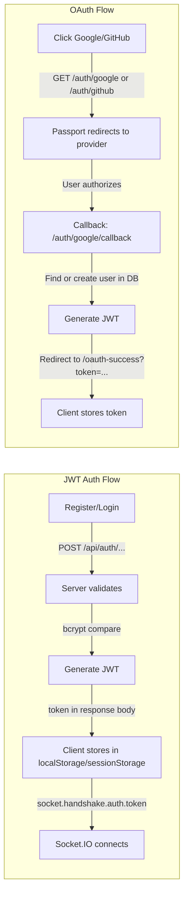

#### JWT Configuration

| Scenario | Expiry | Storage |
|----------|--------|---------|
| Login (Remember Me ✓) | 30 days | `localStorage` |
| Login (Remember Me ✗) | 1 hour | `sessionStorage` |
| Register | 7 days | `localStorage` |
| OAuth (Google/GitHub) | 7 days | `localStorage` |

#### Token Payload

```json
{
  "id": 1,
  "iat": 1717398000,
  "exp": 1718002800
}
```

#### Password Hashing

- **Normal registration:** `bcrypt.genSalt(10)` → `bcrypt.hash(password, salt)`
- **OAuth users:** Password set to sentinel values `"google-oauth"` or `"github-oauth"` (not hashed — bcrypt.compare will always fail, preventing email/password login for OAuth accounts)
- **Room passwords:** `bcrypt.hash(password, 10)` on creation, `bcrypt.compare()` on join

#### Rate Limiting

- Applied to ALL `/api/auth/*` routes
- **Window:** 15 minutes
- **Max requests:** 100 per IP per window
- **Response on limit:** `{ error: "Too many login attempts, please try again later." }`

---

### REST API Reference

#### `POST /api/auth/register`

```
Body: { username, email, password }
Response 201: { token, user: { id, username, email } }
Errors: 400 "User already exists", 500 "Registration failed"
```

#### `POST /api/auth/login`

```
Body: { email, password, rememberMe }
Response 200: { token, user: { id, username, email } }
Errors: 400 "User not found", 400 "Invalid credentials", 500 "Login failed"
```

#### `GET /api/auth/me` (Protected)

```
Headers: Authorization: Bearer <token>
Response 200: { id, username, email }
Errors: 401 "Unauthorized", 500 "Failed to fetch user data"
```

#### `GET /auth/google` — Initiates Google OAuth

#### `GET /auth/github` — Initiates GitHub OAuth

#### `POST /api/rooms/create` (Protected)

```
Body: { roomName, password }
Response 201: { roomId }
```

#### `POST /api/rooms/join` (Protected)

```
Body: { roomId, password }
Response 200: { message, members, roomId }
```

---

## Frontend Deep Dive

### Centralized API Helper

**File:** `frontend/src/api/auth.js` (45 lines)

> [!TIP]
> All frontend API calls now go through a centralized helper that sanitizes the backend URL by stripping trailing slashes, preventing double-slash bugs in production deployments.

```javascript
const rawBackend = import.meta.env.VITE_BACKEND_URL || "http://localhost:5001";
export const BACKEND_URL = rawBackend.replace(/\/+$/, "");
```

**Exported Functions:**

| Function | Method | Endpoint | Purpose |
|----------|--------|----------|---------|
| `loginUser(credentials)` | POST | `/api/auth/login` | Login with email/password |
| `registerUser(userData)` | POST | `/api/auth/register` | Register new user |
| `getMe(token)` | GET | `/api/auth/me` | Fetch authenticated user data |
| `logout()` | — | — | Clears localStorage & sessionStorage, redirects to `/login` |

Used by: `LoginPage.jsx`, `SignupPage.jsx`, `OAuthSuccess.jsx`

---

### Routing & Pages

**File:** `frontend/src/App.jsx` (65 lines)

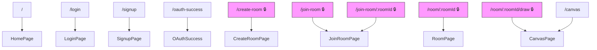

> 🔒 = Protected by `ProtectedRoute` (`components/auth/ProtectedRoute.jsx`) — checks for `token` in localStorage/sessionStorage, redirects to `/login` if missing.

#### Page Descriptions

| Page | File | Lines | Key Features |
|------|------|-------|-------------|
| **HomePage** | `HomePage.jsx` | 98 | Gradient hero with animated blobs, 3 feature cards, "Get Started" / "Guest" buttons |
| **LoginPage** | `LoginPage.jsx` | 192 | Email/password form, Remember Me, Google/GitHub OAuth via `BACKEND_URL`, dark mode toggle |
| **SignupPage** | `SignupPage.jsx` | 176 | Username/email/password form, Google/GitHub OAuth via `BACKEND_URL`, dark mode |
| **OAuthSuccess** | `OAuthSuccess.jsx` | 37 | Reads `?token=` from URL, calls `getMe()` from `api/auth.js`, stores user, redirects |
| **CreateRoomPage** | `CreateRoomPage.jsx` | 32 | Wrapper for `CreateRoomForm`, gradient background |
| **JoinRoomPage** | `JoinRoomPage.jsx` | 32 | Wrapper for `JoinRoomForm`, pre-fills room ID from URL params |
| **RoomPage** | `RoomPage.jsx` | 187 | Room lobby: participant list with avatars, creator badge, invite link, "Start Drawing" button |
| **CanvasPage** | `CanvasPage.jsx` | 13 | Renders `<Canvas />` component |

---

### Redux State Management

**File:** `frontend/src/store/drawingSlice.js` (533 lines)

#### Complete State Shape

```javascript
{
  // === Canvas Elements ===
  lines: [],              // [{points: [x1,y1,x2,y2,...], tool, stroke, strokeWidth, opacity, dash}]
  shapes: [],             // [{id, x, y, width, height, tool, fill, type?, radius?, rotation?}]
  texts: [],              // [{id, x, y, text, fontSize, draggable, fill, fontStyle, fontFamily}]

  // === Undo/Redo ===
  undoHistory: [],         // Stack of snapshots: [{lines, shapes, texts}]
  redoHistory: [],         // Stack of snapshots

  // === Drawing State (Transient) ===
  currentLine: [],         // Points array for line being drawn right now
  currentShape: null,      // Shape preview while dragging
  liveLines: [],           // Other users' lines being drawn (live preview)
  liveShapes: [],          // Other users' shapes being drawn (live preview)

  // === Selection ===
  selectedShapeId: null,   // UUID of selected shape (for Transformer)
  selectedTextId: null,    // UUID of selected text (for editing)

  // === Viewport ===
  zoom: 1,                 // Canvas zoom level (0.2 – 3.0)
  stageX: 0,               // Canvas pan X offset
  stageY: 0,               // Canvas pan Y offset
  showGrid: true,          // Grid visibility toggle

  // === Tool Settings ===
  selectedTool: "select",  // Current tool: select|text|pen|pencil|eraser|square|rectangle|circle|paint
  currentFillColor: "transparent",  // Paint bucket color
  currentStrokeWidth: 2,   // Pen/pencil stroke width (1-10)
  fontFamily: "Arial",     // Default font
  fontStyle: "normal",     // Default style: normal|bold|italic|bold italic
  fontSize: 17,            // Default font size

  // === Room ===
  roomId: null,            // Current room ID
  createdBy: "",           // Room creator username
  users: [],               // [{userId, username}] — connected participants
}
```

#### All 46+ Actions (Grouped by Category)

**Lines:**
- `addLine(line)` — Pushes snapshot to undoHistory, appends line, clears redoHistory
- `updateCurrentLine(points)` — Sets `currentLine` to new points array
- `setLiveLines(lines)` — Bulk-sets other users' live line previews
- `appendLiveLinePoints({points, tool, socketId})` — Appends delta points to the correct live line by `socketId`, or creates a new entry
- `removeLiveLine(socketId)` — Removes a specific user's live line preview when their stroke finalizes

**Shapes:**
- `drawShape(shape)` — Pushes snapshot, appends shape, clears redoHistory
- `updateCurrentShape(shape)` — Updates current shape preview
- `clearCurrentShape()` — Resets `currentShape` to null
- `setLiveShapes(shapes)` — Bulk-sets other users' live shape previews
- `updateLiveShape(shape)` — Upserts a specific user's live shape preview by `socketId`
- `removeLiveShape(socketId)` — Removes a specific user's live shape preview when their shape finalizes
- `deleteShape(id)` — Removes shape by ID

**Undo / Redo:**
- `undoAction()` — Pops from `undoHistory`, pushes current to `redoHistory`, restores snapshot
- `redoAction()` — Pops from `redoHistory`, pushes current to `undoHistory`, restores snapshot
- `clearCanvas()` — Pushes snapshot, clears all elements
- `syncState({lines, shapes, texts})` — Replaces all drawable elements (from remote sync)

**Eraser:**
- `beginErase()` — Takes a single undo snapshot at the start of an erase stroke (fixes memory leak of one snapshot per mouse-move)
- `eraseAt({x, y, radius})` — Segment-splitting algorithm: splits intersected lines into separate segments instead of deleting individual points. Radius is zoom-aware (`20 / zoom`)
- `eraseShape({x, y, radius})` — Erases shapes whose bounding box or center falls within the eraser radius
- `eraseText({x, y, radius})` — Erases text elements whose position falls within the eraser radius

**Text:**
- `addText(textObj)` — Pushes snapshot, appends text
- `setSelectedTextId(id)` — Selects text for property panel
- `updateTextContent({id, text})` — Updates text string
- `updateTextFontStyle({id, fontStyle})` — Updates bold/italic
- `updateTextFontFamily({id, fontFamily})` — Updates font
- `updateTextFontSize({id, fontSize})` — Updates size
- `deleteText(id)` — Removes text by ID
- `deselectText()` — Clears `selectedTextId`

**Position / Transform:**
- `updateLinePosition({index, x, y})` — Moves a line
- `updateShapePosition({id, x, y})` — Moves a shape
- `updateTextPosition({id, x, y})` — Moves a text element
- `setSelectedShapeId(id)` — Selects shape for Transformer
- `updateShapeTransform({id, updatedShape})` — Updates shape dimensions/rotation after transform

**Fill / Color:**
- `setFillColor(color)` — Sets `currentFillColor` for paint bucket
- `resetFillColor()` — Resets to `"transparent"`
- `updateShapeFill({id, fill})` — Applies fill to specific shape
- `updateTextFill({id, fill})` — Applies fill to specific text

**Viewport:**
- `setZoom(level)` — Sets zoom (0.2 – 3.0)
- `setStagePosition({x, y})` — Sets canvas pan offset
- `toggleGrid()` — Toggles grid visibility

**Stroke:**
- `setStrokeWidth(width)` — Sets pen/pencil thickness (1 – 10)

**Tool:**
- `setSelectedTool(tool)` — Switches active tool
- `setFontFamily(family)` — Sets default font family
- `setFontStyle(style)` — Sets default font style

**Room:**
- `setRoomInfo({roomId, createdBy, users})` — Initializes room state
- `updateUsers(users)` — Updates participant list
- `clearRoom()` — Resets room state
- `updateCreatedBy(username)` — Updates creator display

#### Thunk Actions (3)

These use `socket` injected via Redux middleware `thunk.extraArgument`:

```javascript
updateTextFontStyleAndEmit({id, fontStyle})   // dispatch + socket.emit("text:updateFontStyle")
updateTextFontFamilyAndEmit({id, fontFamily}) // dispatch + socket.emit("text:updateFontFamily")
updateTextFontSizeAndEmit({id, fontSize})     // dispatch + socket.emit("text:updateFontSize")
```

#### Undo/Redo Snapshot System

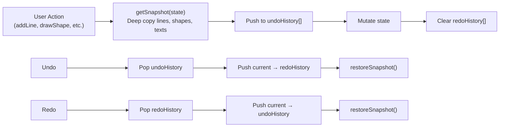

> [!NOTE]
> Every drawing action (addLine, drawShape, addText, clearCanvas, deleteShape, deleteText) pushes a snapshot to `undoHistory` **before** mutating. The eraser uses `beginErase()` to push a **single** snapshot at the start of a stroke — fixing the previous behavior where every mouse-move pushed a snapshot (unbounded memory growth). Undo history still has **no depth limit**.

---

### Canvas Rendering Pipeline (Konva)

**Main File:** `frontend/src/components/canvas/Canvas.jsx` (388 lines)

#### Konva Layer Architecture

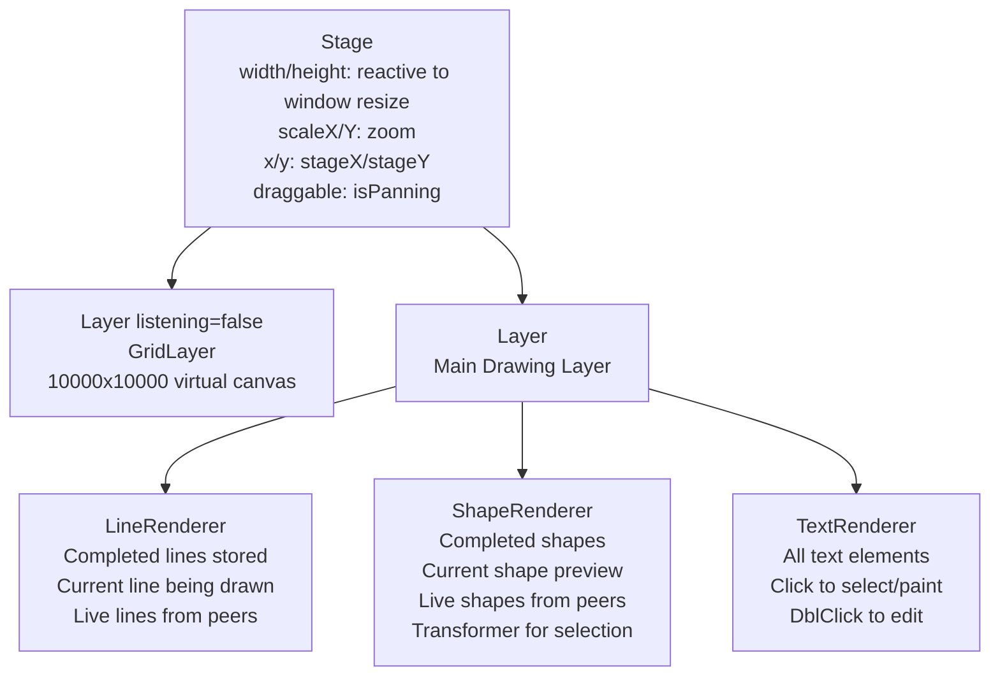

#### Virtual Canvas

- **Size:** 10,000 × 10,000 pixels
- **Zoom range:** 0.2x – 3.0x
- **Panning:** Enabled when `selectedTool === "select"` (cursor: `grab`)
- **Reactive dimensions:** Stage width/height track `window.innerWidth`/`innerHeight` via `useState` + `resize` event listener
- **Pointer position** is transformed to canvas coordinates:
  ```javascript
  x: (screenPos.x - stage.x()) / stage.scaleX()
  y: (screenPos.y - stage.y()) / stage.scaleY()
  ```

#### Component Details

| Component | File | Lines | Key Details |
|-----------|------|-------|------------|
| **Canvas** | `Canvas.jsx` | 388 | Orchestrator. Socket connect with cleanup on unmount, room join, keyboard shortcuts, layout. Uses `useStore()` for encapsulated state access. |
| **DrawingStage** | `DrawingStage.jsx` | 160 | Konva `<Stage>`, reactive window dimensions via useState/useEffect resize listener, wheel zoom (scaleBy 1.05), panning, mouse event routing |
| **GridLayer** | `GridLayer.jsx` | 42 | `<Layer listening={false}>`, 50px grid, `strokeWidth: 1/zoom` (constant visual thickness) |
| **LineRenderer** | `LineRenderer.jsx` | 82 | Renders completed lines, current line, live previews. Pen: `tension 0.5`. Pencil: `tension 0.2`, dashed |
| **ShapeRenderer** | `ShapeRenderer.jsx` | 238 | Rect/Circle/Square, `<Transformer>`, drag/transform end handlers, paint bucket clicks, live previews |
| **TextRenderer** | `TextRenderer.jsx` | 88 | Renders Konva `<Text>`, hides text being edited, click/dblclick handlers, drag support |
| **Toolbar** | `Toolbar.jsx` | 132 | Undo/Redo/Clear buttons, Dark Mode toggle, Grid toggle |
| **Toolbox** | `Toolbox.jsx` | 87 | 9 tool buttons (select, text, pen, eraser, pencil, square, rectangle, circle, paint) |
| **ZoomControls** | `ZoomControls.jsx` | 64 | Glassmorphic pill: +/−/reset/percentage display |
| **ColorPickerWrapper** | `ColorPickerWrapper.jsx` | 46 | ChromePicker from react-color, updates `currentFillColor` |
| **RightPanelTabs** | `RightPanelTabs.jsx` | 97 | 3 tabs: Properties (SettingsPanel), Users (RoomUsersList), Chat (ChatPanel) |
| **SettingsPanel** | `SettingsPanel.jsx` | 50 | Conditional: StrokeWidthPicker for pen/pencil, FontSize/FontStyle for text |
| **StrokeWidthPicker** | `StrokeWidthPicker.jsx` | 39 | Radix Slider, range 1–10 |
| **FontSizeControl** | `FontSizeControl.jsx` | 54 | Number input, range 2–400, emits `text:updateFontSize` |
| **FontStyleSelector** | `FontStyleSelector.jsx` | 76 | Font family dropdown (11 fonts) + style dropdown (normal/bold/italic/bold italic) |
| **ChatPanel** | `ChatPanel.jsx` | 120 | WhatsApp-style bubbles, own messages right-aligned (blue), others left-aligned with avatar |
| **RoomUsersList** | `RoomUsersList.jsx` | 41 | Avatar circles with first letter, "(Creator)" badge |

#### Keyboard Shortcuts

| Shortcut | Action |
|----------|--------|
| `Ctrl + Z` | Undo |
| `Ctrl + Shift + Z` | Redo |
| `Delete` | Delete selected shape/text, or clear all |
| `Ctrl + =` | Zoom in (max 3.0) |
| `Ctrl + -` | Zoom out (min 0.2) |
| `Ctrl + 0` | Reset zoom to 1.0 |
| `Escape` | Deselect shape / Deselect text |

---

### Custom Hooks

#### `useCanvasEvents(selectedTool, stageRef, isEditingText, handleAddText)`

**File:** `frontend/src/hooks/useCanvasEvents.js` (223 lines)

Handles all mouse interactions on the canvas. Returns `{handleMouseDown, handleMouseMove, handleMouseUp, currentShape}`.

All high-frequency drawing events (`draw`, `draw:live`, `drawShape`, `shape:live`, `erase`) are **binary-encoded** using `encode()` from `codec.js` before emission.

| Tool | mouseDown | mouseMove | mouseUp |
|------|-----------|-----------|---------|
| **pen** | `updateCurrentLine([x,y])` | Append points → encode **delta** points → emit `draw:live` (binary) | Create line obj → `addLine` → encode `DrawFinal` → emit `draw` (binary) |
| **pencil** | Same as pen | Same as pen | Same but `stroke="#353839"`, `opacity=0.6`, `dash=[5,5]` |
| **square** | `updateCurrentShape({x,y,w:0,h:0})` | Constrain to square → encode `ShapeLive` → emit `shape:live` (binary) | Add UUID → `drawShape` → encode `ShapeFinal` → emit `drawShape` (binary) |
| **rectangle** | Same as square | Free width/height → emit `shape:live` (binary) | Same as square |
| **circle** | `updateCurrentShape({type:"circle",x,y,radius:0})` | Calculate radius → emit `shape:live` (binary) | Same as square |
| **eraser** | `beginErase()` (single undo snapshot) | Dispatch `eraseAt` + `eraseShape` + `eraseText` locally, batch coords into `eraseBatchRef` | Encode `EraseBatch` → emit `erase` (binary) → clear batch |
| **text** | `handleAddText(pos)` | — | — |
| **select** | — (panning handled by Konva) | — | — |

> [!TIP]
> **Delta Encoding:** `draw:live` tracks `lastSentIndexRef` and only sends the **new points since the last emit**, reducing bandwidth by ~70% for long strokes.

#### `useSocketListeners(socket)`

**File:** `frontend/src/hooks/useSocketListeners.js` (190 lines)

Registers 14 socket event listeners in a single `useEffect`, with proper cleanup on unmount.

All high-frequency drawing events are **decoded from binary** using `decode()` from `codec.js`:
- `draw` → `decode("DrawFinal", buffer)` → `addLine()` + `removeLiveLine(socketId)`
- `draw:live` → `decode("DrawLive", buffer)` → `appendLiveLinePoints()` (delta accumulation by `socketId`)
- `drawShape` → `decode("ShapeFinal", buffer)` → `drawShape()` + `removeLiveShape(socketId)`
- `shape:live` → `decode("ShapeLive", buffer)` → `updateLiveShape()` (upsert by `socketId`)
- `erase` → `decode("EraseBatch", buffer)` → `beginErase()` + loop `eraseAt` / `eraseShape` / `eraseText`

#### `useTextEditing(stageRef, socket)`

**File:** `frontend/src/hooks/useTextEditing.js` (276 lines)

Manages the complete text editing lifecycle:

1. **Create text** → Dispatch `addText` + emit `text:start` → 80ms delay → open native `<textarea>` overlay
2. **Edit text** → Position `<textarea>` exactly over Konva text node using `getClientRect()` + stage transforms
3. **Commit** → On blur/Ctrl+Enter: `updateTextContent` + emit `text:update`
4. **Cancel** → Escape key removes the textarea without saving

> [!TIP]
> The textarea is a **native DOM element** overlaid on top of the Konva canvas, styled to match the canvas text (font, size, color, position). This is a common pattern because Konva's `<Text>` doesn't support inline editing.

#### `useTextDeselect(stageRef)`

**File:** `frontend/src/hooks/useTextDeselect.js` (41 lines)

Two deselection triggers:
- Click on empty canvas area → `deselectText()`
- Press `Escape` key → `deselectText()`

---

### Component Hierarchy

```
App.jsx
├── HomePage.jsx
├── LoginPage.jsx (uses loginUser, BACKEND_URL from api/auth.js)
├── SignupPage.jsx (uses registerUser, BACKEND_URL from api/auth.js)
├── OAuthSuccess.jsx (uses getMe from api/auth.js)
├── CreateRoomPage.jsx
│   └── CreateRoomForm.jsx
├── JoinRoomPage.jsx
│   └── JoinRoomForm.jsx
├── RoomPage.jsx
│   └── InviteLink.jsx
└── CanvasPage.jsx
    └── Canvas.jsx (useStore for encapsulated Redux access, socket cleanup on unmount)
        ├── Header Row (responsive flex: col on small, row on xl)
        │   ├── InviteLink.jsx (room info bar)
        │   ├── Toolbar.jsx
        │   │   └── useTextDeselect hook
        │   └── ZoomControls.jsx
        ├── Toolbox.jsx (desktop sidebar / mobile grid)
        ├── ColorPickerWrapper.jsx (conditional: paint tool)
        ├── DrawingStage.jsx (reactive window dimensions)
        │   ├── GridLayer.jsx
        │   ├── LineRenderer.jsx
        │   ├── ShapeRenderer.jsx (+ Transformer)
        │   ├── TextRenderer.jsx
        │   ├── useCanvasEvents hook (+ codec.js encode)
        │   ├── useTextEditing hook
        │   └── useSocketListeners hook (+ codec.js decode)
        ├── ZoomControls.jsx (bottom-left overlay)
        └── RightPanelTabs.jsx (collapsible, 300px)
            ├── SettingsPanel.jsx
            │   ├── StrokeWidthPicker.jsx
            │   ├── FontSizeControl.jsx
            │   └── FontStyleSelector.jsx
            ├── RoomUsersList.jsx
            └── ChatPanel.jsx
```

---

### Room Components

| Component | File | Socket Events | Key Features |
|-----------|------|--------------|-------------|
| **CreateRoomForm** | `CreateRoomForm.jsx` (153 lines) | Emits `room:create` | Room name + optional password, dark mode toggle, sign out |
| **JoinRoomForm** | `JoinRoomForm.jsx` (159 lines) | Emits `room:join` | Pre-fills roomId from URL params, password field |
| **InviteLink** | `InviteLink.jsx` (42 lines) | — | Generates `origin/room/:id?password=...`, clipboard copy with "Copied!" feedback |

---

## Real-Time Collaboration — Complete Data Flows

### 🖊️ Drawing a Freehand Line (Binary + Delta Encoded)

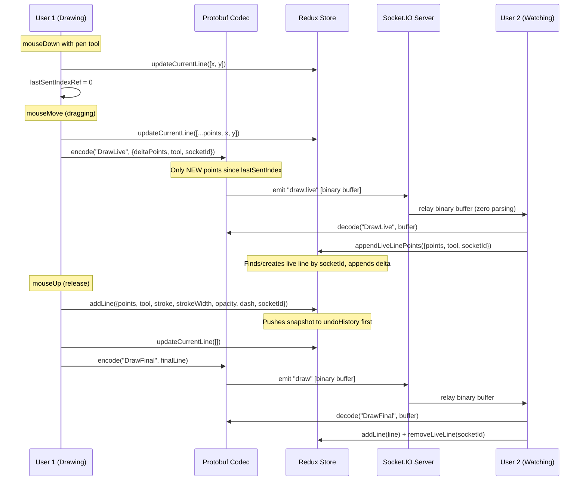

### 🔷 Drawing a Shape (Rectangle/Square/Circle)

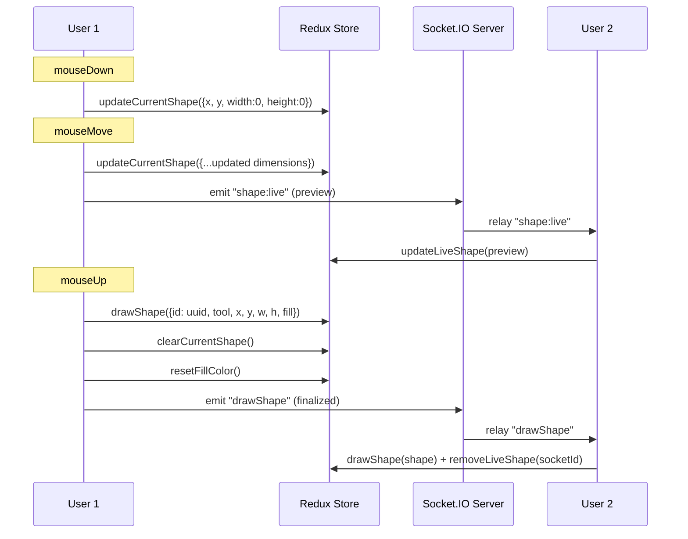

### 📝 Creating & Editing Text

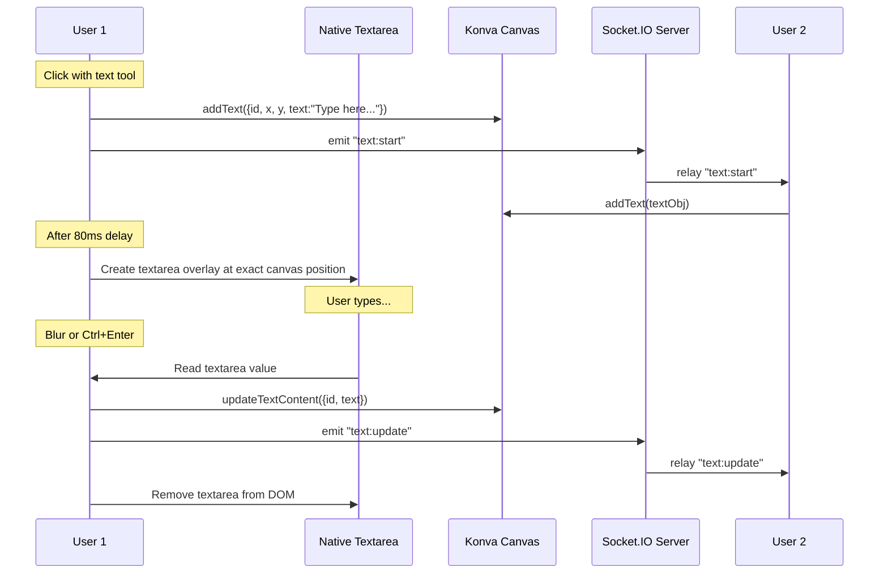

### ↩️ Undo / Redo (Full State Sync)

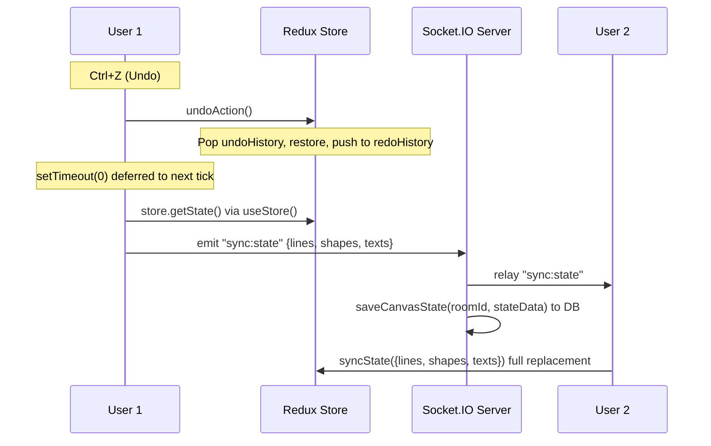

> [!IMPORTANT]
> Undo/Redo performs a **full state sync** — the entire canvas state (lines, shapes, texts) is broadcast to all peers. This is a simple but expensive approach; it works well for small-to-medium canvases but could be optimized with operation-based sync (OT/CRDT) for production scale.

### 🧹 Erasing (Segment Splitting + Shapes + Text)

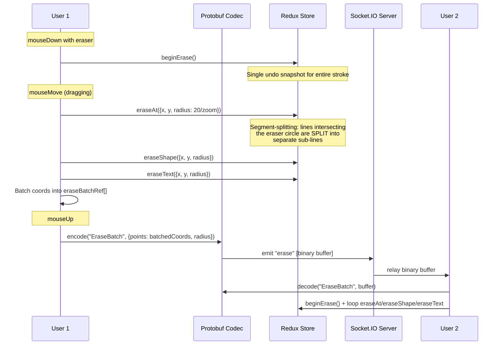

### 🎨 Paint Bucket (Fill)

```
1. User selects paint tool → ColorPickerWrapper opens
2. User picks a color → setFillColor(color)
3. User clicks a shape → updateShapeFill({id, fill}) + emit "shape:fill" + resetFillColor
   OR clicks text → updateTextFill({id, fill}) + emit "text:fill" + resetFillColor
4. Other users receive "shape:fill"/"text:fill" → update locally
```

### 💬 Chat

```
1. User types message → onSendMessage({username, text, timestamp: Date.now()})
2. emit "room:message" {roomId, message}
3. Server: saveMessage() → INSERT INTO messages → broadcast to ALL (io.to, including sender)
4. All clients: receive "room:message" → append to local messages[]
```

---

## Performance Optimizations

### Implemented Optimizations

| Technique | Where | Impact |
|-----------|-------|--------|
| **Protocol Buffer Binary Encoding** | `codec.js` — `encode()`/`decode()` for `draw`, `draw:live`, `drawShape`, `shape:live`, `erase` | Replaces JSON payloads with compact binary buffers. **Up to ~70% bandwidth reduction** for high-frequency drawing events |
| **Delta-Encoded `draw:live`** | `useCanvasEvents.js` — `lastSentIndexRef` | Previously sent entire accumulated points array on every mouse-move (O(N²) bandwidth). Now sends only new points since last emit — **linear bandwidth** |
| **Per-socketId Live State** | `appendLiveLinePoints`, `updateLiveShape`, `removeLiveLine`, `removeLiveShape` | Supports **true multi-user live preview** — each user's in-progress stroke is tracked independently by `socketId` |
| **Segment-Splitting Eraser** | `drawingSlice.js` — `eraseAt` | Replaces naive point-deletion with line-splitting algorithm. Lines are split into clean sub-segments at intersection, eliminating rubber-banding artifacts |
| **Single Undo Snapshot per Erase Stroke** | `drawingSlice.js` — `beginErase()` | Old eraser pushed a full canvas snapshot on **every mouse-move** (unbounded memory leak). Now pushes **one** snapshot when you click down |
| **Batched Eraser Emission** | `useCanvasEvents.js` — `eraseBatchRef` | Eraser coordinates are collected during the stroke and emitted as a single `EraseBatch` protobuf on mouseUp |
| **Zoom-Aware Eraser Radius** | `useCanvasEvents.js` — `radius: 20 / zoom` | Eraser feels consistent at any zoom level |
| **Shape & Text Erasing** | `eraseShape`, `eraseText` in `drawingSlice.js` | Eraser now works on shapes (bounding-box check) and text elements (position check), not just freehand lines |
| **`shallowEqual` selectors** | `Canvas.jsx` — 5 Redux selectors use `shallowEqual` comparison | Prevents re-renders when selector returns same values. Measured **~15% render time reduction** |
| **`useMemo` on drawingStageProps** | `Canvas.jsx` | Memoizes props object passed to `<DrawingStage>`, preventing child re-renders on unrelated state changes |
| **`useCallback` on handlers** | `Canvas.jsx` (6 handlers), `useTextEditing.js` (4 handlers) | Stabilizes function references to prevent child re-renders |
| **`listening={false}` on non-interactive layers** | `GridLayer` (entire layer), `LineRenderer` (live lines), `ShapeRenderer` (live shapes) | **58% reduction in Konva hit detection CPU cost** |
| **WebSocket-only transport** | `socket.js` — `transports: ["websocket"]` | Bypasses HTTP long-polling, reduces connection overhead |
| **Deferred socket emission** | `Canvas.jsx` — `setTimeout(() => emit, 0)` after dispatch | Ensures Redux reducer has completed before reading state for socket sync |
| **Live preview architecture** | Separate `liveLines`/`liveShapes` state | Prevents mixing transient remote previews with committed drawing data |
| **PostgreSQL idle error handling** | `db.js` — `pool.on("error")` + `pool.query("SELECT 1")` for verification | Prevents backend crash when idle database connections drop unexpectedly |
| **Reactive Canvas Dimensions** | `DrawingStage.jsx` — `useState` + `resize` event listener | Stage width/height update dynamically when browser window is resized |
| **Socket Cleanup on Unmount** | `Canvas.jsx` — `useEffect` cleanup emits `leave-room` and calls `socket.disconnect()` | Prevents socket/memory leaks when navigating away from the canvas |
| **Centralized API URL Sanitization** | `api/auth.js` — `BACKEND_URL` strips trailing slashes | Prevents double-slash bugs in production API calls |
| **Encapsulated Store Access** | `Canvas.jsx` — `useStore()` from react-redux | Replaces direct store import, maintaining React-Redux encapsulation |
| **Responsive Canvas Header** | `Canvas.jsx` — flex header row with `xl:flex-row` breakpoint | Room info, toolbar, and zoom controls flow naturally in document order instead of absolute positioning |

### Measured Performance Metrics

| Metric | Value | Method |
|--------|-------|--------|
| **P2P Sync Latency (Localhost)** | ~2ms median | Timestamped `draw:live` events, measured in browser console |
| **P2P Latency Under Load (30 users)** | ~22.7ms average, <25ms peak | Automated load test with 30 simulated concurrent users |
| **Render Optimization** | ~15% render time improvement | React DevTools Profiler, with vs without `shallowEqual` |
| **Layout Effect Optimization** | ~37% improvement | React DevTools Profiler |
| **Konva Hit Detection** | 58% scripting CPU reduction | Chrome DevTools Performance panel, `listening={false}` vs default |
| **Concurrent User Capacity** | 30+ users, stable | Automated WebSocket load test script |
| **Bandwidth Reduction (Protobuf)** | ~70% for drawing payloads | Binary vs JSON payload size comparison |
| **Eraser Undo Memory** | 1 snapshot/stroke (was N snapshots) | Profiled undo history growth before/after |

---

## Docker & Deployment

### Docker Compose Architecture

```yaml
# docker-compose.yml (v3.8)

services:
  frontend:    # Vite dev server
    build: ./frontend
    ports: 5173:5173
    depends_on: backend

  backend:     # Express + Socket.IO
    build: ./backend
    ports: 5001:5001
    env_file: ./backend/.env
    depends_on:
      db:
        condition: service_healthy  # Waits for PostgreSQL

  db:          # PostgreSQL
    image: postgres:latest
    restart: always
    environment:
      POSTGRES_USER: postgres
      POSTGRES_PASSWORD: postgres
      POSTGRES_DB: drawing_app
    volumes:
      - pgdata:/var/lib/postgresql/data
      - ./init.sql:/docker-entrypoint-initdb.d/init.sql
    healthcheck:
      test: pg_isready -U postgres
      interval: 10s
      retries: 5
      timeout: 5s
```

### Running Locally

```bash
# Start all services
docker-compose up --build

# Frontend: http://localhost:5173
# Backend:  http://localhost:5001
# PostgreSQL: localhost:5432
```

### Backend Dockerfile

```dockerfile
FROM node:24-alpine
WORKDIR /app
COPY package.json package-lock.json ./
RUN npm install
COPY . .
EXPOSE 5001
CMD ["node", "server.js"]
```

---

## Known Issues & Bugs

> [!NOTE]
> All 13 bugs from the original audit have been **resolved**. See the changelog below.

### Previously Fixed Bugs (All Resolved ✅)

#### Backend (7/7 Fixed)

| # | Severity | File | Issue | Resolution |
|---|----------|------|-------|------------|
| 1 | ✅ Fixed | `roomRoutes.js` | `createRoom()` and `joinRoom()` called without `await` | Added `async`/`await` to route handlers |
| 2 | ✅ Fixed | `authMiddleware.js` | JWT_SECRET fallback casing mismatch (`"your_secret_key"` vs `"Your_secret_key"`) | Standardized to `"Your_secret_key"` across all modules |
| 3 | ✅ Fixed | `roomService.js` | Room passwords stored in plaintext | Now uses `bcrypt.hash()` on creation and `bcrypt.compare()` on join |
| 4 | ✅ Fixed | `server.js` | Typo: `"No tojen provided"` | Corrected to `"No token provided"` |
| 5 | ✅ Fixed | `Dockerfile` | `EXPOSE 5050` but server listens on `5001` | Changed to `EXPOSE 5001` |
| 6 | ✅ Fixed | `package.json` | `express-validator` installed but unused | Removed from dependencies |
| 7 | ✅ Fixed | `passport.js` | GitHub email used `profile.email` instead of `profile.emails` | Now checks `profile.emails?.[0]?.value` first |

#### Frontend (6/6 Fixed)

| # | Severity | File | Issue | Resolution |
|---|----------|------|-------|------------|
| 8 | ✅ Fixed | `SignupPage.jsx` | OAuth links hardcoded to localhost | Uses `BACKEND_URL` from `api/auth.js` |
| 9 | ✅ Fixed | `SignupPage.jsx` | Register API hardcoded to localhost | Uses `registerUser()` from `api/auth.js` |
| 10 | ✅ Fixed | `Canvas.jsx` | Socket connection had no unmount cleanup | Added `leave-room` emit + `socket.disconnect()` in useEffect cleanup |
| 11 | ✅ Fixed | `api/auth.js` | File was unused — pages had inline fetch calls | Centralized with `loginUser`, `registerUser`, `getMe`, `logout` + `BACKEND_URL` |
| 12 | ✅ Fixed | `Canvas.jsx` | Imported Redux `store` directly, breaking encapsulation | Replaced with `useStore()` from `react-redux` |
| 13 | ✅ Fixed | `DrawingStage.jsx` | `window.innerWidth/Height` not reactive to resize | Added `useState` + `resize` event listener for reactive dimensions |

### Remaining Issues

> [!WARNING]
> The following minor issues remain and should be addressed for production hardening.

| # | Severity | File | Issue |
|---|----------|------|-------|
| 1 | 🟢 Low | `lib/socket.js` | Still uses raw `import.meta.env.VITE_BACKEND_URL` without trailing slash sanitization (should import `BACKEND_URL` from `api/auth.js`) |
| 2 | 🟡 Medium | `drawingSlice.js` | Undo history has **no depth limit** — unbounded memory growth for very long sessions |
| 3 | 🟡 Medium | `server.js` | `express-session` uses `MemoryStore` in production (leaks memory, doesn't scale past single process) |
| 4 | 🟢 Low | `package.json` (frontend) | `fabric` (^7.4.0) and `recoil` (^0.7.7) are installed but appear unused |
| 5 | 🟢 Low | `authRoutes.js` | No password strength validation on registration |

---

## 🗂️ Complete File Inventory

### Backend (13 files)

```
backend/
├── .env                    # Environment variables (DB, JWT, OAuth secrets)
├── .gitignore              # 35 lines
├── Dockerfile              # 21 lines — Node 24 Alpine, EXPOSE 5001
├── package.json            # 26 lines — ESM, 13 deps
├── package-lock.json
├── server.js               # 292 lines — Express + Socket.IO server
├── db.js                   # 25 lines — pg Pool connection (pool.query verification) + idle error handler
├── config/
│   └── passport.js         # 77 lines — Google + GitHub OAuth strategies (profile.emails fix)
├── middleware/
│   └── authMiddleware.js   # 21 lines — JWT verification (consistent "Your_secret_key" fallback)
├── routes/
│   ├── authRoutes.js       # 89 lines — Register, Login, Me (with rate limiting)
│   ├── oauthRoutes.js      # 44 lines — OAuth initiate + callback
│   └── roomRoutes.js       # 35 lines — REST room create/join (async/await fixed)
└── services/
    └── roomService.js      # 151 lines — Room CRUD, bcrypt password hashing, in-memory + DB
```

### Frontend (52 source files)

```
frontend/src/
├── main.jsx                # 15 lines — Entry: Provider + BrowserRouter
├── App.jsx                 # 65 lines — Route definitions
├── App.css                 # Empty
├── index.css               # 121 lines — Tailwind v4, CSS variables, dark mode
├── api/
│   └── auth.js             # 45 lines — BACKEND_URL sanitization, loginUser, registerUser, getMe, logout
├── proto/
│   ├── drawing.proto       # 60 lines — Protobuf schema (DrawLive, DrawFinal, ShapeLive, ShapeFinal, EraseBatch)
│   ├── drawing.json        # 183 lines — Compiled protobuf descriptor
│   └── codec.js            # 33 lines — encode(type, payload) / decode(type, buffer) helper
├── hooks/
│   ├── useCanvasEvents.js  # 223 lines — Mouse events + protobuf encoding + delta draw:live
│   ├── useSocketListeners.js # 190 lines — Socket events + protobuf decoding
│   ├── useTextDeselect.js  # 41 lines — Text deselection
│   └── useTextEditing.js   # 276 lines — Text creation/editing/positioning
├── lib/
│   ├── socket.js           # 20 lines — Socket.IO client config
│   ├── utils.js            # 7 lines — cn() helper
│   └── getStoredUser.js    # 13 lines — User retrieval from storage
├── store/
│   ├── store.js            # 15 lines — Redux store config (socket as thunk.extraArgument)
│   └── drawingSlice.js     # 533 lines — 46+ actions, full state management
├── pages/
│   ├── HomePage.jsx        # 98 lines
│   ├── LoginPage.jsx       # 192 lines — uses loginUser + BACKEND_URL from api/auth
│   ├── SignupPage.jsx      # 176 lines — uses registerUser + BACKEND_URL from api/auth
│   ├── OAuthSuccess.jsx    # 37 lines — uses getMe from api/auth
│   ├── CreateRoomPage.jsx  # 32 lines
│   ├── JoinRoomPage.jsx    # 32 lines
│   ├── RoomPage.jsx        # 187 lines
│   └── CanvasPage.jsx      # 13 lines
├── components/
│   ├── auth/
│   │   └── ProtectedRoute.jsx  # Route guard — checks token in storage
│   ├── canvas/
│   │   ├── Canvas.jsx          # 388 lines — Main orchestrator (useStore, socket cleanup)
│   │   ├── DrawingStage.jsx    # 160 lines — Konva Stage (reactive dimensions)
│   │   ├── GridLayer.jsx       # 42 lines
│   │   ├── LineRenderer.jsx    # 82 lines
│   │   ├── ShapeRenderer.jsx   # 238 lines
│   │   ├── TextRenderer.jsx    # 88 lines
│   │   ├── Toolbar.jsx         # 132 lines
│   │   ├── Toolbox.jsx         # 87 lines
│   │   ├── ZoomControls.jsx    # 64 lines
│   │   ├── ColorPickerWrapper.jsx  # 46 lines
│   │   ├── RightPanelTabs.jsx  # 97 lines
│   │   ├── SettingsPanel.jsx   # 50 lines
│   │   ├── StrokeWidthPicker.jsx   # 39 lines
│   │   ├── ChatPanel.jsx       # 120 lines
│   │   ├── RoomUsersList.jsx   # 41 lines
│   │   └── Text/
│   │       ├── FontSizeControl.jsx     # 54 lines
│   │       └── FontStyleSelector.jsx   # 76 lines
│   ├── room/
│   │   ├── CreateRoomForm.jsx  # 153 lines
│   │   ├── JoinRoomForm.jsx    # 159 lines
│   │   └── InviteLink.jsx      # 42 lines
│   └── ui/                     # shadcn/ui primitives
│       ├── button.jsx          # 56 lines
│       ├── label.jsx           # 24 lines
│       ├── slider.jsx          # 55 lines
│       ├── switch.jsx          # 28 lines
│       └── tooltip.jsx         # 54 lines
├── assets/
│   └── react.svg
```

### Root & Config Files

```
LiveInk/
├── docker-compose.yml      # 39 lines — 3 services
├── init.sql                # 28 lines — 3 tables
├── Readme.md               # This document
├── package-lock.json       # 7 lines (root)
├── frontend/
│   ├── .env                # 2 lines — VITE_BACKEND_URL
│   ├── .dockerignore       # 7 lines
│   ├── Dockerfile          # 23 lines — Node 24 Alpine, Vite build + dev server
│   ├── vite.config.js      # 15 lines — React + Tailwind plugins, @ alias
│   ├── compile_proto.js    # 10 lines — Protobuf compilation script
│   ├── load_test.js        # 240 lines — Automated WebSocket load test (30 users)
│   ├── package.json        # 30 deps + 12 devDeps
│   └── ...
└── backend/
    └── ...
```

---

> [!TIP]
> **Quick Start:**
> ```bash
> git clone <repo>
> cd LiveInk
> docker-compose up --build
> # Open http://localhost:5173
> ```

---

*Last updated: 2026-07-22 (v3 — All audit bugs fixed, centralized API helpers, bcrypt room passwords, reactive canvas dimensions)*
